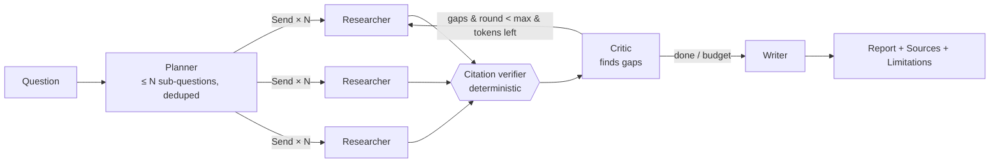

# multi-agent-research-crew

[](https://github.com/ndanetaadmire-debug/multi-agent-research-crew/actions/workflows/ci.yml)


**A supervisor-style team of AI agents that researches a question and writes a cited report, where every claim is checked against its source in code before it reaches the writer.**

Multi-agent demos are easy to build and hard to trust: researchers invent citations, critics loop forever and costs balloon. This crew is designed around those three failure modes.

```
$ npm run demo -- "How is online retail growing in South Africa, and what limits delivery?"
· plan       → 2 sub-questions
· research   "How is online retail growing in South Africa"  verified 2, rejected 0
· research   "what limits delivery"                          verified 2, rejected 0
· critique   gaps: none → stop: complete

Online retail in South Africa grew 24% in 2024 according to industry estimates. [1]
Same-day delivery is now common in Johannesburg and Cape Town. [2]
Delivery costs remain a barrier in rural areas. [2]

## Sources
[1] E-commerce in South Africa — https://example.org/za-ecommerce
[2] Courier market overview — https://example.org/couriers
```

## Architecture



- **Parallel fan-out** with LangGraph `Send`: each sub-question is researched concurrently; the critic runs once per round, after all researchers finish.
- **Deterministic citation verifier** after every researcher, before anything reaches the writer:
  1. cited sources must be ones the researcher was actually given (no invented URLs),
  2. the sources must contain most of the claim's content words, and
  3. **every number** in the claim must appear in a cited source (42% vs 24% is caught).

  Rejected claims are dropped and counted in the report's **Limitations** section.
- **Bounded revision loop:** the critic can request follow-up research; questions already asked are never repeated; `maxRounds` caps the loop, and unanswered gaps are reported, not hidden.
- **Token budget:** usage from every role is accumulated in graph state; when the budget is reached the crew stops researching and writes what it has, saying so.
- **Stable references:** sources are numbered 1..n in order of first citation, deduplicated across researchers, and only cited sources are listed.

## Roles are ports

`Planner`, `Researcher`, `Critic`, `Writer` and `SearchTool` are small interfaces. Production wiring uses LLMs (typically a stronger model for planning and critique, a cheaper one for the parallel researchers) and a web or enterprise search tool. The repo ships deterministic offline implementations so the demo and CI run with no API keys.

## Tests

The tests run the real compiled LangGraph graph with scripted roles:
- duplicate sub-questions are removed, and the critic runs once per round,
- a hallucinating researcher's invented numbers and URLs are dropped and disclosed,
- critic gaps trigger exactly one more round and the next gap is reported as open,
- the token budget stops the crew with an honest report,
- already-researched questions are never re-asked,
- the no-evidence path produces "No verified findings" without calling the writer.

```bash
npm ci
npm run demo
npm run ci     # typecheck + 8 tests (99% coverage) + build
```

Related: [victor-ai-agent](https://github.com/ndanetaadmire-debug/victor-ai-agent) · [agent-eval-harness](https://github.com/ndanetaadmire-debug/agent-eval-harness) · [llm-guardrails-kit](https://github.com/ndanetaadmire-debug/llm-guardrails-kit)

---

Built by **[Admire T. Ndaneta](https://admire-portfolio.vercel.app)**. MIT licensed.
